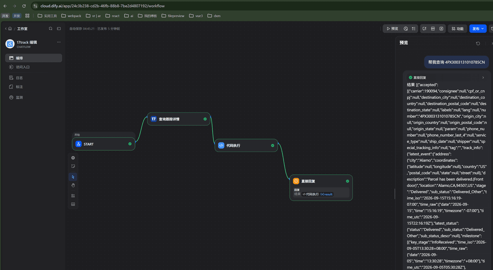

# 17TRACK Dify Plugin

Cross-border e-commerce order tracking for 3500+ carriers with automatic status updates.

Official API doc (11 endpoints): https://asset.17track.net/api/document/v2.4_zh/index.html

Source repository: https://github.com/electroluxcode/dify-plugin-17track

## Setup

1. Get a 17TRACK API key from [17TRACK API Settings](https://api.17track.net/admin/settings)
   (free plan available).
2. Install the plugin and authorize the credential with your API key. The key is sent as
   the `17token` header and validated against the `getquota` endpoint on save.

## Usage (11 tools)

- **get_quota** — get the current tracking and email quota counters for the 17TRACK account
- **register_trackings** — register up to 40 tracking numbers for automatic tracking by 17TRACK
- **get_tracking_details** — get current tracking details for up to 40 registered tracking numbers
- **list_trackings** — list registered shipments with status and pagination filters
- **stop_trackings** — stop automatic tracking for up to 40 registered tracking numbers
- **restart_trackings** — restart automatic tracking for up to 40 stopped tracking numbers
- **delete_trackings** — permanently delete up to 40 registered tracking numbers
- **push_trackings** — queue a webhook push of the latest tracking results
- **change_carrier** — change the carrier of registered tracking numbers
- **update_tracking_info** — update the metadata (tag, language, remark) of registered tracking numbers
- **get_realtime_tracking_details** — query a single tracking number against carriers in real time

All requests go to the official 17TRACK API (`https://api.17track.net/track/v2.4`).

## Runtime screenshot

Dify 工作流实际运行效果(输出变量含 JSON 结构化数据):

